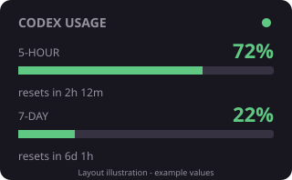

# Codex Usage for Rainmeter

A compact Windows desktop skin showing **used** Codex quota for the 5-hour and weekly windows, with reset times. Independent community project; not affiliated with OpenAI.



Companion: [Claude Usage for Rainmeter](https://github.com/Noppadol1144/rainmeter-claude-usage).

## Requirements

- Windows, PowerShell, and [Rainmeter](https://www.rainmeter.net/).
- Codex installed and signed in with a ChatGPT account that supplies Codex quota.

The collector locates `codex.exe` on PATH or in the current user's OpenAI/Codex/bin directory. Other installation layouts can be tested using the collector's `-CodexPath` parameter. API-key billing and ChatGPT chat-message limits are not shown.

## Install

Download or clone this repository, extract it, open PowerShell in its directory, and run:

```powershell
powershell.exe -NoProfile -ExecutionPolicy Bypass -File .\Install.ps1
```

Refresh Rainmeter, then load `CodexUsage/CodexUsage.ini`. The installer reads Rainmeter's configured Skins directory and backs up an existing skin before copying files. For a portable installation, supply `-SkinPath "C:/your/Rainmeter/Skins"`.

Alternatively, copy `skin/CodexUsage` into your Rainmeter Skins directory. All runtime paths are relative to the installed skin.

## Usage

- Refreshes every five minutes while loaded; click to refresh immediately.
- Bars show **used**, not remaining, quota.
- Green dot: last read succeeded. Red dot: last read failed; cached values may be stale.
- Hover over the dot for the last successful timestamp and state.
- Missing windows show `--`. Actual window durations select the 5-hour and weekly rows.
- Reset countdowns update on each successful read; they do not tick continuously.

## How data is read

The collector starts a temporary local Codex app-server, initializes it, calls the documented [`account/rateLimits/read`](https://learn.chatgpt.com/docs/app-server) method, then closes its child process. It relies on Codex's existing local sign-in and does not read or copy tokens itself. It sends no inference prompt. No scheduled task or separate API key is required.

The generated `@Resources/usage_status.txt` contains usage figures and timestamps and is excluded from Git. Failed reads preserve the last good values and mark their state as an error.

## Troubleshooting

Make sure Codex is signed in. To check the collector manually from the repository directory:

```powershell
powershell.exe -NoProfile -ExecutionPolicy Bypass -File .\skin\CodexUsage\@Resources\poll_usage.ps1
Get-Content .\skin\CodexUsage\@Resources\usage_status.txt
```

An unsupported account, unavailable Codex service, or changed app-server protocol can prevent updates. The widget does not invent quota when data is unavailable.

## Uninstall

Unload `CodexUsage` in Rainmeter and remove its installed skin directory. No scheduled task is created. Backup directories created by the installer can be removed separately.

## License

MIT. See [LICENSE](LICENSE). The layout was adapted from the companion Claude Usage skin.
